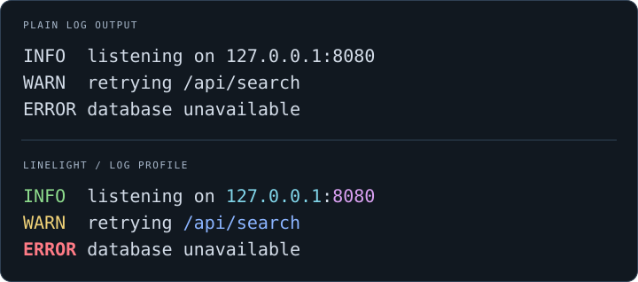

<div align="center">

# Linelight

**Put your output in the limelight.**

A command-line filter and runner that make plain logs and command output easier to scan.

[Get started](#get-started) · [Examples](#examples) · [Profiles](#profiles) · [Customization](#customization)

</div>



Pipe in text and choose a profile. Linelight highlights useful details while
preserving the original text. All 11 built-in profiles travel with the binary,
which runs on its own on a supported remote host.

## Get started

Build from source on Linux with Git, a [stable Rust toolchain](https://rust-lang.org/tools/install/),
and a system linker:

```sh
git clone https://github.com/smprather/linelight.git
cd linelight
cargo build --release --locked
./install.sh
```

Installation needs no sudo: the executable goes in `~/.local/bin`, the manual
in `~/.local/share/man`. Add `~/.local/bin` to your `PATH` for the examples below.

Try it in your terminal:

```sh
printf '%s\n' \
    'INFO  listening on 127.0.0.1:8080' \
    'WARN  retrying /api/search' \
    'ERROR database unavailable' |
    ~/.local/bin/linelight filter --profile log
```

Rust is needed only for building; the installed binary runs offline. Published
Linux x86_64 release binaries are linked against glibc 2.28 (the EL8 floor) and
are smoke-tested on AlmaLinux 8. Build that artifact locally with
`./scripts/build-glibc228.sh`; the tag release workflow builds the exact tarball,
verifies the extracted binary's symbol floor and NEEDED set, smoke-tests it on
AlmaLinux 8, and publishes that artifact.

<details>
<summary>Use a different install location</summary>

```sh
env PREFIX="$HOME/tools/linelight" ./install.sh
"$HOME/tools/linelight/bin/linelight" --version
```

The installer also accepts `BINDIR`, `MANDIR`, and `DESTDIR`. To try Linelight
without installing, use `./target/release/linelight`.

</details>

## Examples

**Read command output:**

```sh
df -h | linelight filter --profile df
ps aux | linelight filter --profile ps
ss -ltn | linelight filter --profile ss
```

**Read a log file, or follow it as it grows:**

```sh
linelight filter --profile log < app.log
tail -f app.log | linelight filter --profile log
```

**Keep color when using a pager:**

```sh
diff -u old.txt new.txt |
    linelight filter --profile diff --color always |
    less -R
```

> [!TIP]
> Auto mode checks Linelight's **output**. When piping to `less -R`, use
> `--color always`; when redirecting to a file, leave auto mode on for plain text.

In Bash or Zsh scripts, use `set -o pipefail` when the source command's exit
status matters. The shell determines the status of the pipeline.

## Run a command

`run` puts the same filter around a child process:

```sh
linelight run --profile df -- df -h
linelight run --profile log --stderr -- make
linelight run --profile ps --pty -- ps aux
```

The profile is explicit; there is no command-line matcher hidden behind the
runner. With colour off for both streams, `run` execs the command directly with
no pipe. Otherwise it forwards the child's exit status (or `128+N` when the
child dies from signal `N`), forwards HUP/TERM/QUIT, and leaves the child in the
terminal's foreground process group so Ctrl-C, Ctrl-Z, and `fg` behave like the
plain command. Stdin is inherited.

`--stderr` filters stderr separately, using its own destination to make the
auto-colour decision. The streams stay separate; ordering between them is best
effort. `--pty` gives only stdout a pseudoterminal, preserving `isatty(1)`, line
buffering, and terminal width; stdin and stderr remain real. `--pty` and
`--stderr` are not combined in this release. Partial records are passed through
by `run` so prompts without a trailing newline remain visible; this can leave a
record unstyled if it arrives in pieces. A background descendant that keeps
stdout open also keeps the filter reading until it closes, exactly as in a shell
pipeline.

## Profiles

Every profile below is included in the binary; configuration is optional.

| Profile | Use with |
| --- | --- |
| [`log`](profiles/log.toml) | Line-oriented application logs |
| [`df`](profiles/df.toml) | GNU filesystem-usage tables |
| [`diff`](profiles/diff.toml) | Unified `diff -u` output |
| [`dig`](profiles/dig.toml) | BIND DNS answers |
| [`free`](profiles/free.toml) | procps memory summaries |
| [`ls`](profiles/ls.toml) | GNU `ls -l` with English date formatting |
| [`lsblk`](profiles/lsblk.toml) | util-linux block-device trees |
| [`ping`](profiles/ping.toml) | Ordinary iputils ping output |
| [`ps`](profiles/ps.toml) | procps process tables |
| [`sensors`](profiles/sensors.toml) | lm-sensors Celsius readings |
| [`ss`](profiles/ss.toml) | iproute2 socket tables |

Profiles target output that is plain by default; opt-in native color does not
disqualify a profile. Prefer native output when a command already colors its
ordinary terminal output well.

## Color and streaming

| Mode | Behavior |
| --- | --- |
| `--color auto` (default) | Adds color when stdout is a terminal and the environment allows it |
| `--color always` | Adds color even through a pipe or into a file |
| `--color never` | Copies input without adding color |

A nonempty `NO_COLOR` or `TERM=dumb` disables auto color. An explicit
`--color always` or `--color never` takes precedence.

Line endings and a missing final newline are preserved. Records containing
ANSI escapes, control bytes, or invalid UTF-8 pass through unchanged, as do
records reaching the default 64 KiB limit. Change the limit with `--max-record N`.

> [!NOTE]
> `filter` is a line-oriented filter. Ordinary partial lines wait for a newline,
> EOF, or the record limit; progress/control markers flush immediately. `run`
> passes partial records through so prompts remain visible; a record that
> arrives in pieces can be left unstyled.

## Customization

User configuration lives in `~/.config/linelight`, or under your configured
`XDG_CONFIG_HOME` root.

### Add a profile

Profiles are TOML files pairing regular expressions with named styles. For a
tool that prints build-check results, save this as `build.toml`:

```toml
schema = 1
id = "build"
name = "Build checks"

[[rule]]
regex = '^PASS\b'
style = "success"

[[rule]]
regex = '^FAIL\b'
style = "error"
```

Validate it, then try it:

```sh
linelight check ./build.toml
printf 'PASS compile\nFAIL timing check\n' |
    linelight filter --profile ./build.toml
```

Keep it as `~/.config/linelight/profiles/build.toml` to select it by name with
`--profile build`.

Later rules override earlier styles. Named groups can style parts of a match;
the [built-in profiles](profiles/) show how.
Available styles are `heading`, `muted`, `accent`, `identifier`, `path`,
`number`, `success`, `warning`, and `error`. Profiles are data-only; they cannot
execute commands or rewrite text.

<details>
<summary>Profile lookup and overrides</summary>

Linelight looks for a requested profile in this order:

1. An explicit file, such as `--profile ./build.toml`.
2. The user profile directory under `XDG_CONFIG_HOME` or `~/.config`.
3. Directories supplied with `--profile-dir DIR`, highest priority first.
4. The embedded defaults.

Files in profile directories must be named `<id>.toml` and declare that ID.
Overrides replace whole profiles; a broken requested override reports an error.

</details>

### Change the colors

Create `~/.config/linelight/palette.toml`:

```toml
[palette]
error = "bold bright_red"
warning = "yellow"
path = "underline cyan"
```

Entries change styles across all profiles; omitted entries keep their defaults.
Combine named colors with attributes such as `bold`, `dim`, and `underline`.
Your terminal's palette determines how the colors look.

For a one-off palette, pass `--palette ./palette.toml` to `filter`, `explain`,
or `check`.

## Shell adapters

`init` prints wrapper definitions for the interactive shell:

```sh
eval "$(linelight init bash)"       # ~/.bashrc
eval "$(linelight init zsh)"        # ~/.zshrc
eval "`linelight init tcsh`"        # ~/.tcshrc
linelight init fish | source        # config.fish
```

Only commands that have an effective profile and are on `PATH` when `init`
runs are wrapped. `log` is never wrapped, and `ls` is off by default because
many users already define it. Existing aliases and functions win. Disable
individual names in `~/.config/linelight/adapters.toml`:

```toml
schema = 1
disable = ["ps", "diff"]
```

Set `LINELIGHT_INIT=0` to make `init` print nothing. The wrappers call
`linelight run --profile NAME -- NAME ARGS`, so they make no colour decision
themselves and exec directly when colour is off. Bash and Zsh keep their
name-based completion; Fish copies completion with `--wraps`.

## Command reference

| Command | Purpose |
| --- | --- |
| `linelight filter --profile ID` | Read stdin and write styled text to stdout |
| `linelight run --profile ID -- COMMAND` | Run a command through the filter |
| `linelight init SHELL` | Print shell wrappers |
| `linelight profiles` | List effective profiles and their sources |
| `linelight explain --profile ID` | Show a profile's source, palette, and rules |
| `linelight check [PATH...]` | Validate profile files, or all effective profiles and the palette |

Run `linelight --help` for options, or `man linelight` after installation.
See the [manual source](linelight.1) and [design notes](DESIGN.md) for more detail.

## Development

```sh
cargo fmt -- --check
cargo clippy --all-targets -- -D warnings
cargo test
cargo build --release
./tests/deploy.sh
./tests/completion.sh
./scripts/build-glibc228.sh
target/release/linelight check
```

`tests/deploy.sh` installs into a prefix containing spaces with a clean
HOME/XDG environment and a read-only executable. `tests/completion.sh` seeds
completion for wrapped names, sources the generated bash/zsh/tcsh/fish
adapters, and confirms both the wrapper and its completion registration
survive.
